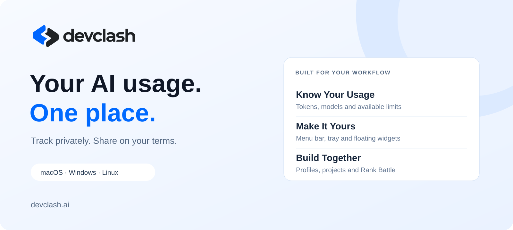

  

  <strong>Your AI usage. One place.</strong> 
  Track your tools, understand your activity, and share your progress on your terms.

  <a href="https://devclash.ai/download"><strong>Download DevClash</strong></a> ·
  <a href="https://devclash.ai">Website</a> ·
  <a href="https://app.devclash.ai/discover">Discover Builders</a> ·
  <a href="https://github.com/devclash-ai/devclash/issues">Feedback</a>

---

## Meet DevClash

DevClash brings AI usage from **Claude, Codex, Cursor and OpenCode** into a desktop app for **macOS, Windows and Linux**. See tokens, model breakdowns, estimated API-rate value and available provider limits without switching between tools.

Keep your activity local, or sign in and enable cloud sync to save your history across devices. Join the community when you want to share your profile, showcase projects and take part in Rank Battle.

> This is DevClash's public product and feedback repository. Application source code is maintained privately.

## Built For Your Daily Workflow

| Feature | What You Can Do |
| --- | --- |
| **Usage At A Glance** | Explore daily, weekly and monthly token totals, trends and model breakdowns. |
| **Provider Details** | Expand a provider to explore available project-level usage and model details. Coverage depends on the tool and available usage records. |
| **Limits And Resets** | See provider quotas and reset times when supported and available for your signed-in account. |
| **Floating Widgets** | Choose your metrics, size, appearance and transparency. Keep useful information close while you work. |
| **Menu Bar And Tray** | Access DevClash quickly and choose the available status display options for your platform. |
| **Optional Cloud History** | Sign in through the browser and choose whether to sync usage metadata. |
| **Rank Battle** | Opt into token-based leaderboards, explore supported periods and model filters, and earn usage badges. Public rankings use UTC periods and client-reported usage. |
| **Builder Profiles** | Share a public profile and link the projects you are building. |
| **Sharing** | Share usage cards and public links without exposing your prompts or credentials. |

Estimated API-rate value is an estimate based on token pricing, not your subscription bill. Missing usage or quota information is shown as unavailable rather than guessed.

## Download

**[Get the current desktop release →](https://devclash.ai/download)**

| Platform | Packages | Installation |
| --- | --- | --- |
| **macOS** | Apple Silicon and Intel DMG | Open the DMG, drag DevClash to Applications, then launch it. Requires macOS 13 or later. |
| **Windows** | x64 setup executable | Run the installer on Windows 10 or 11. The app uses Microsoft WebView2. |
| **Linux** | x64 DEB and AppImage | Install the DEB on a compatible Debian-based system, or make the AppImage executable and launch it. Desktop tray and keyring support vary by environment. |

Mac releases are Developer ID signed and notarized. Windows installers are signed; SmartScreen may still show a reputation warning. Desktop updater packages use signed updates.

The app includes **Check for Updates** and an option to disable automatic updates. The website always links to the current published packages.

[Release Notes And Existing Downloads](https://github.com/ccycv/devclash-releases/releases) · [Installation Help](https://devclash.ai/download#installation)

## Get Started

1. Install DevClash for your operating system.
2. Use your supported AI tools as usual. DevClash reads available local usage records or authenticated provider usage APIs.
3. Open the dashboard and customize the metrics, provider order and widgets you want to see.
4. Optionally sign in through your browser and enable cloud sync.
5. Choose separately whether to publish a profile or participate in public rankings.

An account is not required for local usage tracking. Provider authentication and available history determine what DevClash can display. Some integrations may require an operating-system credential permission or provider sign-in.

## Privacy By Choice

- **Local by default.** You can use the desktop tracker without a DevClash account.
- **Cloud sync is optional.** When enabled, usage metadata can include token totals, model names, times and estimated costs.
- **Your content stays private.** Prompts, replies, source code, local paths and provider credentials are not uploaded to DevClash as part of usage sync.
- **Public participation is separate.** Cloud sync does not automatically opt you into public rankings or publish your profile.

[Read The Privacy Policy](https://devclash.ai/privacy) · [Terms](https://devclash.ai/terms) · [Account Deletion](https://devclash.ai/delete-account)

## Feedback And Support

Found a problem or have an idea? [Open an issue](https://github.com/devclash-ai/devclash/issues/new/choose).

Include your operating system, DevClash version and the steps needed to reproduce the issue. Remove email addresses, tokens, prompts, private project paths and other sensitive details from screenshots and logs before posting.

For account-specific help or a potential security issue, use [private support](https://devclash.ai/support) instead of a public issue.

## About This Repository

This repository contains public product information, brand assets and community feedback. It does not contain the application source or replace the existing download and update infrastructure.

DevClash is built by **FUTUREFORGE LABS SRL**. Product names and logos belong to their respective owners. Publishing this repository does not grant an open-source license to the DevClash application or its brand assets.

<a href="https://devclash.ai"><strong>Build With AI. Get Seen For It.</strong></a>

